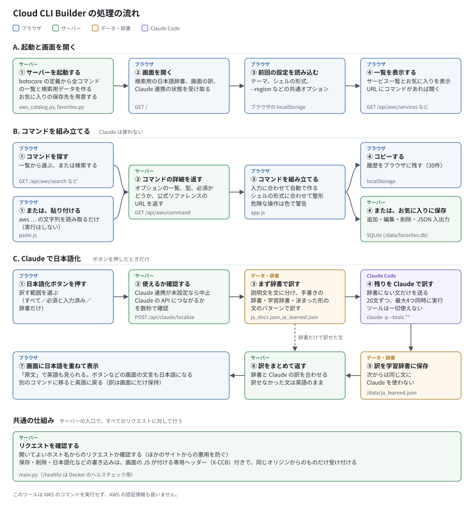

# Cloud CLI Builder

画面でパラメータを入力して、**AWS CLI のコマンドを組み立てる** ツールです。

- [botocore](https://github.com/boto/botocore) の定義から、全サービス・全コマンド・全オプションを自動で用意します。
  botocore は AWS が公開している Python のライブラリで、AWS CLI も内部でこれを使っています。全サービスの API の定義（操作・パラメータ・型・説明文）が入っており、このツールはその定義を読むだけです（AWS の API は呼び出しません）。
- 組み立てるだけで、コマンドの **実行はしません**。AWS の認証情報も扱いません。
- 画面は英語です。説明文は、ボタンを押すと Claude で日本語にできます（任意）。
- 今は AWS CLI に対応しています。Google Cloud（`gcloud`）への対応も予定しています。

## 目次

1. [起動する](#起動する)
2. [使い方](#使い方)
3. [主な機能](#主な機能)
4. [Claude で日本語化する（任意）](#claude-で日本語化する任意)
5. [ファイル構成](#ファイル構成)
6. [設定（.env）](#設定env)
7. [処理の流れ](#処理の流れ)
8. [API 仕様](#api-仕様)
9. [注意点](#注意点)

## 起動する

Docker Compose v2.24 以降が必要です。

```bash
docker compose up -d --build
```

ブラウザで http://localhost:8080 を開きます。

| 操作 | コマンド |
|---|---|
| 停止 | `docker compose down` |
| 変更を反映して再起動 | `docker compose up -d --build` |
| お気に入りなどのデータも含めて削除 | `docker compose down -v` |

お気に入りと学習辞書は、Docker のボリューム `cli-builder-data`（コンテナ内の `/data`）に保存されます。コンテナを作り直しても消えません。

### 新しいサービス・コマンドを取り込む

使うライブラリのバージョンは `requirements.txt` で固定しているので、そのままでは新しい AWS のサービスやコマンドは増えません。取り込むときは、`botocore==` を新しいバージョン（[PyPI](https://pypi.org/project/botocore/#history)）に書き換えてから `docker compose up -d --build` で作り直します。

使っている botocore のバージョンは、トップ画面のいちばん下に表示されます。

### テストを実行する

```bash
docker compose run --rm test
```

Python（pytest）と JavaScript（`node --test`）のテストを、Docker の中で実行します。テストはネットワークにつながずに動き、実際の Claude は呼びません。テスト用のツールは本番のイメージには入りません。

## 使い方

1. **コマンドを探す** — 左の一覧でサービス → コマンドの順に選ぶか、上の検索欄で探します。
2. **（または）コマンドを貼り付ける** — ブログやドキュメントの `aws ...` を検索欄（または画面のどこか）に貼ると、入力欄が埋まった状態で開きます。
3. **パラメータを入力する** — 入力に合わせて、画面上部のコマンドが組み上がります。
4. **コピーする** — シェルの形式（Bash / PowerShell / コマンドプロンプト / .bat ファイル / 1行）を選んで「Copy command」を押します。
5. **お気に入りに保存する** — 「＋ Add to favorites」で名前とメモを付けて保存します。「★ Favorites」から入力状態ごと呼び出せます。

## 主な機能

- **全コマンド対応** — botocore の全サービス・全コマンドに加え、CLI 独自のコマンド（`s3 cp` / `logs tail` など）と `wait` コマンドも収録
- **検索** — コマンド名の単語の先頭で一致（`inst` → `describe-instances`）。`ec2 stop` のようにサービスで絞れる。「インスタンス 一覧」のような日本語でも探せる
- **貼り付けて読み込む** — ブログやドキュメントの `aws ...` を貼ると、入力欄が埋まった状態で開く
- **シェルの形式** — Bash / PowerShell / コマンドプロンプト / .bat ファイル / 1行 に合わせて、改行記号と引用符を切り替える
- **危険な操作の警告** — 削除系は赤、停止系は黄色で表示。`--dry-run` があれば付けられる
- **お気に入りと履歴** — 名前・メモ付きで保存し、入力状態ごと復元できる。コピーした履歴も30件残る
- **日本語表示** — トップ画面は「日本語」ボタンで、コマンドの画面は「🤖 Claudeで日本語化」で日本語にできる
- **URL で直接開く** — `http://localhost:8080/#/aws/ec2/describe-instances`

## Claude で日本語化する（任意）

コマンドの画面の説明文を日本語にする機能です。設定しなくても、ほかの機能はすべて使えます。

### 設定する

1. 手元の PC で `claude setup-token` を実行し、トークンを取得します（Claude Pro / Max のプランが必要）。
2. `.env` を作ってトークンを貼り付けます。

   ```bash
   cp .env.example .env
   # .env の CLAUDE_CODE_OAUTH_TOKEN= にトークンを貼り付ける
   ```

3. `docker compose up -d --build` で起動し直します。

トップ画面の「Claude 連携」に「利用できます」と表示されれば完了です。

従量課金の `ANTHROPIC_API_KEY` には対応していません（環境にあっても Claude Code には渡しません）。

### 使う

コマンドの画面で「🤖 Claudeで日本語化」を押します。横の選択欄で、訳す範囲を選べます。

| 範囲 | 内容 |
|---|---|
| All fields | すべての説明文を訳す |
| Required & filled only | 必須の項目と入力済みの項目だけ訳す（速くて安い。オプションが多いコマンド向け） |
| Dictionary only (no Claude) | 辞書にある文だけ訳す。Claude は呼ばない |

訳は画面に重ねて表示され、「原文」で英語も見られます。

### 仕組み（Claude に送る量を減らす工夫）

1. 説明文を文に分け、まず辞書で訳します。
   - `app/ja_docs.json` … 手書きの辞書（自由に追記できます）
   - `/data/ja_learned.json` … 学習辞書（Claude が訳した文が自動で追記されます）
   - `wait` コマンドの説明など、決まった形の文はパターンで訳します。
2. **辞書にない文だけ** を Claude Code（`claude -p`）に送ります。20文ずつに分け、最大4つを並行して訳します。
3. 訳した文は学習辞書に保存されるので、同じ文は次回から Claude を使いません。一部が失敗しても、もう一度押すと残りだけを訳します。

同じ文が両方の辞書にあるときは、手書きの `ja_docs.json` が優先されます。

### 安全性とデータの扱い

- Claude はボタンを押したときだけ実行されます。
- Claude Code は `--tools ""` で起動するので、ツールを一切使えません（Web の読み込み、コマンドの実行、ファイルの読み書きはできません）。念のため、ツールを拒否する設定も付けています。
- 実行ごとに一時ディレクトリを作り、終了後に削除します。会話ログも保存しません（`--no-session-persistence`）。コンテナの `/tmp` はメモリ上（tmpfs）なので、ディスクにも残りません。
- 訳の結果は画面に表示するだけです。例外として、botocore の公開されている説明文の訳だけは学習辞書に保存します。組み立てたコマンドや入力した値は保存しません（`CLAUDE_SAVE_TRANSLATIONS=0` で保存しないようにできます）。
- 送った内容の Anthropic 側での扱いは、Anthropic のデータ利用ポリシー（ご利用のプランの規約）に従います。

## ファイル構成

```text
app/
  main.py             Flask（画面と API）
  aws_catalog.py      botocore → AWS CLI のコマンド定義
                        CUSTOM_COMMANDS … CLI 独自のコマンド（s3 cp など）
                        GLOBAL_OPTIONS  … 共通オプションとその候補（リージョンなど）
  claude_assist.py    Claude Code との連携（日本語化）
  ja.py               日本語辞書
                        AWS_SERVICE_JA / AWS_COMMAND_JA … サービス・コマンドの日本語名
                          （AWS_SERVICE_JA の書いた順がサービス一覧の並び順）
                        SEARCH_VERBS / SEARCH_NOUNS     … 日本語検索の語彙
  ja_docs.py          説明文を辞書で訳す処理
  ja_docs.json        説明文の翻訳辞書（英語の文 → 日本語。自由に追記できる）
  ui_ja.json          画面の文言の日本語訳（{0} は可変部分）
  favorites.py        お気に入り（SQLite）
  templates/ static/  画面（HTML / JS / CSS / フォント）
                        static/paste.js … 貼り付けたコマンドの読み取り
                        static/quote.js … シェルの形式ごとの引用符の付け方
tests/                テスト（Python は pytest、tests/js/ は node --test）
docs/
  flow.svg            処理の流れの図
Dockerfile            本番（app）とテスト（test）のイメージ。元のイメージと Claude Code のバージョンを固定
docker-compose.yml    本番（cli-builder）とテスト（test）の起動設定
.env.example          設定のひな形（コピーして .env を作る）
requirements.txt      Python ライブラリ（バージョン固定。botocore の更新はここ）
requirements-dev.txt  テスト用のライブラリ（バージョン固定）
```

`app/` の中のファイル（辞書を含む）を編集したら、`docker compose up -d --build` で反映します。

## 設定（.env）

`.env.example` をコピーして `.env` を作り、必要な項目だけ書き換えます。変更後は `docker compose up -d --build` で起動し直してください。

| 項目 | 既定値 | 内容 |
|---|---|---|
| `CLAUDE_CODE_OAUTH_TOKEN` | なし | Claude のプランのトークン。日本語化に必要 |
| `CLAUDE_MODEL` | `sonnet` | 使うモデル（`sonnet` / `opus` / `haiku` など） |
| `CLAUDE_TRANSLATE_MODEL` | `CLAUDE_MODEL` と同じ | 翻訳に使うモデル。`haiku` にすると速くて安い |
| `CLAUDE_SAVE_TRANSLATIONS` | `1` | `0` にすると、Claude の訳を学習辞書に保存しない |
| `CLAUDE_TIMEOUT` | `300` | 1回の実行の上限時間（秒） |
| `CLAUDE_MAX_BUDGET_USD` | `1.00` | 1回の実行の上限金額（米ドル） |
| `CLAUDE_MAX_CONCURRENCY` | `4` | 同時に実行する Claude の数 |
| `CLAUDE_TRANSLATE_CHUNK` | `20` | 1回の Claude に送る文の数 |
| `ALLOWED_HOSTS` | なし | 他の端末から開くときのホスト名（カンマ区切り）。[注意点](#注意点) を参照 |

## 処理の流れ



## API 仕様

画面（`app/static/app.js`）が使っている、サーバー（`app/main.py`）の API です。

### 共通の決まり

- `<provider>` に入るのは、今は `aws` だけです。それ以外は 404 になります。
- 開いてよいホスト名（`localhost` / `127.0.0.1` / `::1` と `ALLOWED_HOSTS` で足したもの）以外からのリクエストは 403 になります。
- POST / PUT / DELETE には、ヘッダー `X-CCB: 1` が必要です。`Origin` ヘッダーがある場合は、同じオリジンでなければ 403 になります。
- 本文とレスポンスは JSON です。エラーのときは `{"error": "メッセージ"}` を返します。
- 本文の大きさは 5MB までです。超えると 413 になります。

### 一覧

| メソッド | パス | 内容 |
|---|---|---|
| GET | `/` | 画面（HTML） |
| GET | `/api/<provider>/services` | サービスの一覧 |
| GET | `/api/<provider>/services/<service>` | サービスのコマンド一覧 |
| GET | `/api/<provider>/command` | コマンドの詳細 |
| GET | `/api/<provider>/search` | コマンドの横断検索 |
| GET | `/api/favorites` | お気に入りの一覧 |
| POST | `/api/favorites` | お気に入りの追加 |
| PUT | `/api/favorites/<id>` | お気に入りの編集 |
| DELETE | `/api/favorites/<id>` | お気に入りの削除 |
| POST | `/api/favorites/<id>/use` | お気に入りの使用回数を1増やす |
| GET | `/api/favorites/export` | お気に入りのエクスポート |
| POST | `/api/favorites/import` | お気に入りのインポート |
| POST | `/api/claude/localize` | 表示中のコマンドの日本語化 |
| GET | `/healthz` | 動作確認（Docker のヘルスチェック用） |

### 画面

#### `GET /`

画面の HTML を返します。次の値を、実行されない JSON（`<script type="application/json" id="bootData">`）として埋め込みます。CSP でインラインのスクリプトを禁止しているためです。

| 値 | 内容 |
|---|---|
| `ja_search` | 日本語検索の辞書（`app/ja.py` の `SEARCH_VERBS` / `SEARCH_NOUNS`） |
| `claude` | Claude 連携の状態（`available` / `reason` / `reason_ja` / `model`） |
| `ui_ja` | 画面の文言の日本語訳（`app/ui_ja.json`） |

トップ画面の下には、botocore のバージョンも表示します。

### コマンドの情報

#### `GET /api/<provider>/services`

サービスの配列を、名前順で返します。

| 項目 | 内容 |
|---|---|
| `name` | CLI でのサービス名（例: `ec2`） |
| `title` | 正式名（例: `Amazon Elastic Compute Cloud`） |
| `ja` | 日本語名（`app/ja.py` にあるものだけ。なければ空） |
| `count` | コマンドの数 |
| `rank` | 並び順（`app/ja.py` の `AWS_SERVICE_JA` の順。載っていなければ 9999） |
| `doc_url` | サービスの公式リファレンスの URL |

#### `GET /api/<provider>/services/<service>`

コマンドの配列を、名前順で返します。サービスがなければ空の配列です。

| 項目 | 内容 |
|---|---|
| `name` | コマンド名（例: `describe-instances`、`wait instance-running`） |
| `op` | botocore の操作名（例: `DescribeInstances`）。CLI 独自のコマンドは `null` |
| `summary` | 説明の最初の1文（英語） |
| `ja` | 日本語の説明（辞書にあるもの、または動詞から自動で作ったもの） |
| `required` | 必須パラメータの数 |
| `doc_url` | 公式リファレンスの URL |
| `waiter` / `custom` | `wait` コマンド／CLI 独自のコマンドのときだけ `true` |

#### `GET /api/<provider>/command?service=<service>&name=<command>`

コマンドの詳細を返します。見つからなければ 404 です。

| 項目 | 内容 |
|---|---|
| `service` / `name` / `op` | サービス名・コマンド名・botocore の操作名 |
| `summary` / `description` | 説明の最初の1文／説明の全文（最大1200文字。英語） |
| `ja` / `service_ja` | コマンド・サービスの日本語名 |
| `doc_url` / `service_doc_url` | 公式リファレンスの URL |
| `positionals` | 位置引数（`name` / `doc` / `required`） |
| `params` | オプション（下の表）。必須のものが先、その中は名前順 |
| `pagination` | ページ送りのオプション（`--max-items` など）。ページ送りのないコマンドは空 |
| `global_options` | 共通オプション（`--region` / `--profile` など） |

`params` の各項目:

| 項目 | 内容 |
|---|---|
| `name` | オプション名（例: `--instance-ids`） |
| `key` | botocore のパラメータ名（例: `InstanceIds`） |
| `type` | `string` / `number` / `boolean` / `enum` / `list` / `json` |
| `required` | 必須なら `true` |
| `doc` | 説明（最大600文字。英語） |
| `neg` | `boolean` のとき、打ち消しのオプション名（例: `--no-dry-run`） |
| `choices` | `enum` と `list` のとき、選べる値 |
| `example` / `shorthand` | `json` のとき、JSON のひな形と簡略構文の例 |
| `hint` | 入力のヒント（例: ファイルを渡すときは `fileb://path`） |

#### `GET /api/<provider>/search?q=<検索語>`

コマンドを横断して検索します。先頭の `aws` は無視します。1語目がサービス名なら、そのサービスに絞ります。

| 項目 | 内容 |
|---|---|
| `results` | コマンド名・サービス名で一致したもの（最大150件） |
| `descriptions` | 説明文で一致したもの（最大40件）。`results` が10件未満のときだけ返す |
| `total` | `results` に一致した全件数 |
| `service` | サービスで絞り込んだときのサービス名。絞っていなければ `null` |

`results` と `descriptions` の各項目は、`service` / `service_ja` / `name` / `ja` / `summary` / `doc_url` / `curated`（日本語名を手で登録したコマンドなら `true`）です。

### お気に入り

お気に入りの各項目は次のとおりです。

| 項目 | 内容 |
|---|---|
| `id` | 番号 |
| `provider` | 必須。今は `aws` だけ |
| `title` | 必須。名前 |
| `command` | 必須。コマンドの文字列 |
| `memo` | メモ |
| `service` / `operation` | サービス名・コマンド名 |
| `doc_url` | 公式リファレンスの URL（`https://` で始まらないものは空にして保存） |
| `state` | 画面の入力状態（ビルダーで開き直すときに使う）。オブジェクトでなければ `{}` として保存 |
| `use_count` | 使った回数 |
| `created_at` / `updated_at` | 作成・更新の日時 |

| メソッドとパス | 本文 | レスポンス |
|---|---|---|
| `GET /api/favorites?provider=<provider>` | なし（`provider` は省略可） | 配列。使った回数の多い順、次に更新の新しい順 |
| `POST /api/favorites` | お気に入りの項目（`id` などは不要） | 作成したもの（201）。オブジェクトでない、または必須の項目がなければ 400 |
| `PUT /api/favorites/<id>` | 変更する項目だけ | 更新したもの。なければ 404、オブジェクトでない・内容が不正なら 400 |
| `DELETE /api/favorites/<id>` | なし | `{"ok": true}`（なかったときは `false`） |
| `POST /api/favorites/<id>/use` | なし | `{"ok": true}` |
| `GET /api/favorites/export` | なし | 全件の JSON ファイル（`cli-favorites.json`） |
| `POST /api/favorites/import` | お気に入りの配列（エクスポートしたもの） | `{"imported": 追加できた件数}`。配列でなければ 400。不正な要素は飛ばす |

### Claude 連携

#### `POST /api/claude/localize`

表示中のコマンドの説明文を日本語にします。辞書で訳せる文は辞書で訳し、辞書にない文だけを Claude に送ります。

本文:

| 項目 | 内容 |
|---|---|
| `provider` / `service` / `name` | 対象のコマンド |
| `scope` | `all`（すべて）/ `filled`（必須と入力済みだけ）/ `dict`（辞書だけ。Claude を呼ばない） |
| `filled` | 入力済みのオプション名の配列（`scope` が `filled` のときに使う） |

レスポンス:

| 項目 | 内容 |
|---|---|
| `title_ja` / `service_ja` | コマンド・サービスの日本語名 |
| `description_ja` | 説明の訳 |
| `params` | 各オプションの説明の訳（`name` / `ja`）。訳せなかった文は英語のまま |
| `_meta` | 件数などの情報（辞書で訳した文の数 `dict_hits`、Claude に送った文の数 `sent`、失敗した文の数 `failed`、モデル、かかった時間、費用の目安） |

エラー:

| ステータス | いつ |
|---|---|
| 404 | コマンドが見つからない |
| 502 | Claude の実行に失敗した（すべての文で失敗したとき。一部だけ失敗したときは 200 で、`_meta.failed` に件数が入る） |
| 503 | Claude 連携が設定されていない |

### その他

#### `GET /healthz`

`{"ok": true}` を返します。Docker のヘルスチェックで使います。

## 注意点

- **このツールはコマンドを組み立てるだけです。** 実行はしません。Claude もコマンドを実行できない設定です。
- **Claude の訳は AI が作ったものです。** 重要な操作の前には、画面に表示される公式リファレンスで確認してください。
- **`.env` の `CLAUDE_CODE_OAUTH_TOKEN` は、あなたの Claude プランを使える鍵です。** 他人に渡したり Git に入れたりしないでください（`.gitignore` 済み）。
- **ローカルからだけ開けます**（`127.0.0.1:8080` で待ち受け）。他の端末から開きたい場合は、`docker-compose.yml` の `ports` を `"8080:8080"` にし、`.env` の `ALLOWED_HOSTS` に開くときのホスト名（例: `192.168.x.x`）を追加します。この場合、同じネットワークの誰でも Claude を実行できる（あなたのプランの使用量を消費する）ようになります。
- 他の Web サイトから勝手に操作されないよう、書き込み系の API は、画面の JS が付ける専用ヘッダー（`X-CCB`）付きで、同じオリジンからのリクエストだけを受け付けます。
- 画面に必要なもの（フォントを含む）はすべて同梱しているので、オフラインでも使えます。インターネットが必要なのは、Claude での日本語化と公式リファレンスへのリンクだけです。
- PowerShell 5.1 では、JSON の引数のダブルクォートが崩れることがあります。JSON を渡すときは PowerShell 7.3 以降を使うか、`file://params.json` の形式にしてください。
